  

  
  
  
  

  

## 👨‍💻 Sobre mí

Desarrollador full stack y líder técnico en Guadalajara. Construyo y opero software de gestión que usan empresas reales, desde el firmware hasta el servidor.

- 🏢 Lidero el desarrollo de **VIVO ERP** en [HISSS](https://www.hisss.com.mx), un ERP multiempresa con facturación CFDI 4.0.
- 🚀 Fundé **[Alkes](https://alkes.mx)**, donde diseñé y opero cinco productos SaaS sobre un núcleo común de autenticación, multiempresa, roles y auditoría.
- ⚙️ Despliego lo que construyo: Docker, Coolify, GitHub Actions, Cloudflare y respaldos cifrados.
- 🤖 Integro IA en producto (OpenAI, Whisper, agentes en n8n y MCP) y trabajo a diario con Claude Code.

## 🧩 Productos que he construido

| Producto | Qué hace | Destacado técnico |
|---|---|---|
| [**Alkes ERP**](https://erp.alkes.mx) | ERP para pymes mexicanas | CFDI 4.0 con timbrado y cancelación vía PAC |
| [**SmartPend**](https://smartpend.alkes.mx) | Gestión de pendientes | Notas de voz → tareas con Whisper y gpt-4o-mini |
| [**Mantis**](https://mantis.alkes.mx) | Gestión de mantenimientos | Activos con QR y checklists configurables |
| [**GeoCheck**](https://geocheck.alkes.mx) | Control de asistencia | Geolocalización y fotografía |
| [**SysPower**](https://syspower.alkes.mx) | Control remoto de equipos | Firmware ESP32 propio con actualizaciones OTA |

> El código de estos productos es privado y con gusto lo muestro en una entrevista técnica. Las páginas públicas de cada uno están abiertas en la sección de proyectos.

## 🛠️ Stack

  
  
  
  
  
  
  
  
  

  
  
  
  
  
  
  
  

  
  
  
  
  
  
  

## 📂 Proyectos abiertos

| Repositorio | Qué demuestra |
|---|---|
| [**smartpend_landing_page**](https://github.com/GustavoQuinteroC/smartpend_landing_page) | Página pública de SmartPend: pendientes y proyectos con folio, historial y formularios públicos |
| [**mantis_landing_page**](https://github.com/GustavoQuinteroC/mantis_landing_page) | Página pública de Mantis: mantenimiento preventivo y correctivo con checklists y evidencias |
| [**geocheck_landing_page**](https://github.com/GustavoQuinteroC/geocheck_landing_page) | Página pública de GeoCheck: control de asistencia por ubicación con NIP, geocerca y foto |
| [**syspower_landing_page**](https://github.com/GustavoQuinteroC/syspower_landing_page) | Página pública de SysPower: reinicio físico remoto de equipos críticos desde el navegador |
| [**erp_landing_page**](https://github.com/GustavoQuinteroC/erp_landing_page) | Página pública de Alkes ERP: gestión empresarial con facturación CFDI 4.0 |
| [**alkes_landing_page**](https://github.com/GustavoQuinteroC/alkes_landing_page) | Sitio de Alkes: software y soluciones TI, hecho a mano en HTML, CSS y JavaScript |
| [**herramientas-web**](https://github.com/GustavoQuinteroC/herramientas-web) | Validador de CFDI 4.0 contra XSD en PHP y generadores de QR, contraseñas y gradientes |
| [**erpNeni**](https://github.com/GustavoQuinteroC/erpNeni) | ERP de ventas e inventarios en Laravel, desplegado en Kubernetes |
| [**tareasOnKubernetes**](https://github.com/GustavoQuinteroC/tareasOnKubernetes) | API REST en PHP con MariaDB, contenerizada y desplegada en Kubernetes |
| [**Airflow**](https://github.com/GustavoQuinteroC/Airflow) | Pipeline ETL de tipos de cambio en Python con Apache Airflow |

## 📊 Actividad

  

---

Guadalajara, México · Abierto a oportunidades remotas, híbridas o presenciales en Guadalajara

